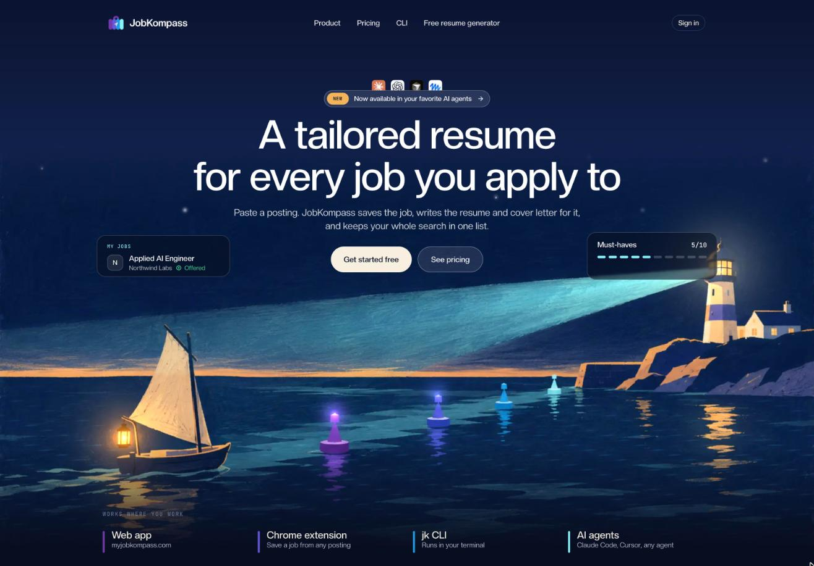
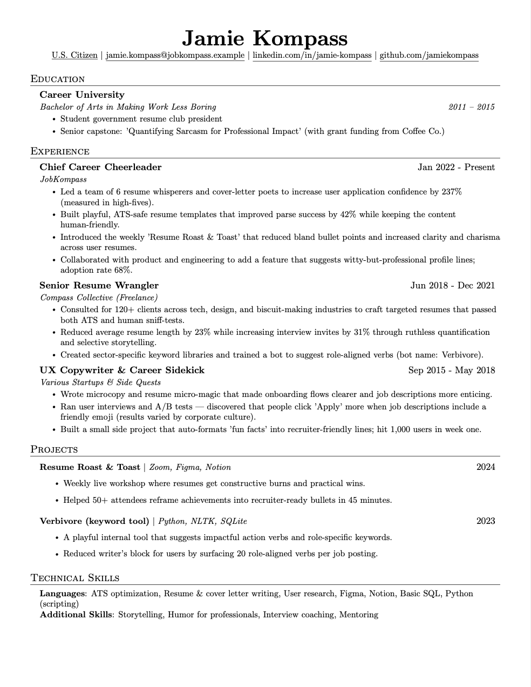

<p align="center">
  
</p>

<h1 align="center">JobKompass</h1>

<p align="center">Save the jobs you want. Get a resume written for each one, from the resume you already have.</p>

<p align="center">
  <a href="https://www.myjobkompass.com"></a>
  <a href="https://www.npmjs.com/package/jobkompass-cli"></a>
  
</p>

<p align="center">
  
</p>

JobKompass is a job-search app. You save the postings you care about, and it writes a resume for each one from the resume you already have. It also writes cover letters, builds interview prep decks, and shows how your search is going. The same account can be driven from a terminal or by an AI agent through the `jk` CLI, and a Chrome extension saves postings from the page you are on.

## Contents

- [What it does](#what-it-does)
- [How it works](#how-it-works)
- [Tech stack](#tech-stack)
- [Repository layout](#repository-layout)
- [Getting started](#getting-started)
- [Checks](#checks)
- [Deploying](#deploying)
- [The jk CLI](#the-jk-cli)
- [Documentation](#documentation)
- [Contributing](#contributing)
- [Security](#security)
- [License](#license)

## What it does

Each item is a screen or a tool you can open today.

- **My Jobs.** A table of saved postings with a status per job (Interested, Applied, Callback, Interviewing, Offered, Rejected, Ghosted), notes, and the resume and cover letter used.
- **My Documents.** Resumes and cover letters, with folders and favorites. One resume is marked as the base resume, and tailored copies are written from it.
- **Resume editor.** Edit a resume section by section with a live PDF preview. There are three templates: Jake, Joseph and Mar. They are defined in [`lib/templates.ts`](lib/templates.ts).
- **Chat.** Ask for a resume tailored to a saved job. The reply shows what changed, which must-haves from the posting your resume covers, and any questions about your bullets.
- **Interview Prep.** A deck per interview: flashcards, stories, requirement matches, questions to ask, and a checklist.
- **Performance.** Stats on your applications.
- **Links & Resources.** Saved links and notes for the search.
- **`jk` CLI.** Jobs, resumes, cover letters, interview preps, email templates, resources and chat threads from a terminal. Built so an AI agent can use it without prompts. See [`cli/README.md`](cli/README.md).
- **Chrome extension.** Sends the text of the page you are on to JobKompass, which parses it and saves the job. The extension's source is not in this repository. Its server endpoint is.
- **Free resume generator.** A public page at `/free-resume-generator` that turns pasted resume text into a formatted PDF in the Jake template. It asks for an email address first.

Some of these depend on the plan. The gates are listed in [docs/ARCHITECTURE.md](docs/ARCHITECTURE.md#plans-and-limits).

## How it works

### Tailoring a resume

1. The base resume is stored as structured JSON, not as a file. Uploaded PDFs and pasted text are converted to that shape first.
2. The writer gets the resume JSON, the job posting, and any answers you gave earlier about specific bullets. Its instructions are in [`lib/resume/writingStandard.ts`](lib/resume/writingStandard.ts).
3. The output is checked before anything is saved. If the model added, removed or reordered a job or a project, the attempt is thrown away and retried.
4. A fact guard ([`lib/resume/noInventedFacts.ts`](lib/resume/noInventedFacts.ts)) compares the output with the source resume. A bullet that states something the source does not is replaced with your original wording.
5. The result is turned into LaTeX for the chosen template and compiled to PDF by a separate service.
6. The PDF and its JSON are saved to Documents, along with a record of what changed and which questions are still open.

<p>
  
  
</p>

Sample output from two of the three templates. Both use placeholder people.

The code for steps 2 to 4 is [`lib/resume/tailorResume.ts`](lib/resume/tailorResume.ts). Steps 5 and 6 are in [`lib/resume/tailorServer.ts`](lib/resume/tailorServer.ts).

### The writer never invents a fact

A good bullet has a number in it. Only you know the number, so the writer is not allowed to supply one. The rule covers employers, titles, dates, schools, tools, skills and results as well.

When a bullet is missing a number or a result, the app asks you one short question about that bullet. Your answer is saved on the base resume and counts as a fact from then on. Every later resume written from that base reuses it, so you are not asked twice.

- Question and answer handling: [`lib/resume/bulletQuestions.ts`](lib/resume/bulletQuestions.ts)
- The same flow for agents: `jk resumes questions`, `jk resumes answer` and `jk resumes tailor`, described under "Resume questions" in [`cli/README.md`](cli/README.md)
- Regression tests for the rule: [`tests/no-invented-experience/`](tests/no-invented-experience/README.md)

## Tech stack

| Layer | What is used |
| --- | --- |
| Web app | Next.js 16 (App Router), React 19, TypeScript |
| Backend and database | Convex: queries, mutations, actions, HTTP routes, file storage |
| Auth | Convex Auth with email and password, and Google sign-in |
| UI | Tailwind CSS 4, shadcn-style components on Radix primitives, Motion |
| AI | OpenRouter for resume writing and extraction, the OpenAI Agents SDK for chat |
| PDF | LaTeX generated in the app and compiled by a separate HTTP service |
| Payments | Stripe Checkout, billing portal and webhook |
| Analytics | PostHog, off unless a key is set |
| Tests | Vitest |
| CLI | Node 18 or newer, Commander, built with tsup |

## Repository layout

| Path | What is in it |
| --- | --- |
| `app/` | Next.js routes. Pages, API routes under `app/api/`, and the product UI under `app/jk-components/`. |
| `app/ai/` | Chat agent instructions and tools. |
| `convex/` | Backend: schema, functions, auth, plan rules, rate limits, and the HTTP routes used by the CLI and the extension. |
| `lib/` | Shared TypeScript. `lib/resume/` holds the tailoring pipeline, the fact guard and the LaTeX generators. |
| `cli/` | The `jk` command line tool, published to npm as `jobkompass-cli`. It has its own `package.json`. |
| `components/` | Shared UI primitives. |
| `providers/` | React context providers for auth, jobs, documents, subscription, theme and others. |
| `hooks/` | React hooks. |
| `types/` | Shared type definitions. |
| `templates/` | LaTeX source for the resume and cover letter templates. |
| `tests/` | Vitest suites that span modules, including the design-token ratchet and the no-invented-experience tests. Unit tests also sit next to the code they cover. |
| `public/` | Fonts and images. |
| `docs/` | Architecture, guides and planning notes. Start at [docs/README.md](docs/README.md). |
| `clients/` | A Replicate client and archived clients that are no longer used. |
| `proxy.ts` | Convex Auth middleware for Next.js. |

## Getting started

### Prerequisites

- Node.js 22 (the version CI uses) and npm
- A Convex account
- An OpenRouter API key for any AI feature
- Optional: Stripe test keys for billing, a LaTeX compile service for PDF export

### Install

```bash
git clone https://github.com/itwela/jobkompass-v3.git
cd jobkompass-v3
npm install
```

### Environment variables

Create `.env.local` in the repo root. Names only are listed here. Never commit values.

Next.js app:

| Variable | Needed for |
| --- | --- |
| `NEXT_PUBLIC_CONVEX_URL` | Everything. The URL of your Convex deployment. |
| `CONVEX_DEPLOYMENT` | The Convex CLI. Written by `npx convex dev`. |
| `OPENROUTER_API_KEY` | Resume tailoring, extraction, must-haves, interview prep. Chat also uses it in development when no OpenAI key is set. |
| `OPENAI_API_KEY` | Chat, chat titles, resume assist and document generation in production builds. |
| `NEXT_PUBLIC_OPENAI_API_KEY` | The same routes in development. Use a development key only. |
| `LATEX_SERVICE_URL` | PDF export. If unset in development, the app calls `http://127.0.0.1:8080`. |
| `RESUME_EXPORT_SECRET` | Lets server code call the resume export route. Must match the value set on the Convex deployment. |
| `STRIPE_SECRET_KEY`, `STRIPE_WEBHOOK_SECRET` | Billing. |
| `NEXT_PUBLIC_STRIPE_STARTER_PRICE_ID`, `NEXT_PUBLIC_STRIPE_PLUS_PRICE_ID`, `NEXT_PUBLIC_STRIPE_PRO_PRICE_ID`, `NEXT_PUBLIC_STRIPE_PLUS_ANNUAL_PRICE_ID`, `NEXT_PUBLIC_STRIPE_PRO_ANNUAL_PRICE_ID` | Billing. |
| `NEXT_PUBLIC_APP_URL` | Stripe return URLs and a few server-side links. |
| `NEXT_PUBLIC_POSTHOG_KEY`, `NEXT_PUBLIC_POSTHOG_HOST`, `NEXT_PUBLIC_POSTHOG_SESSION_REPLAY` | Analytics. Leave the key empty to turn it off. See [docs/analytics.md](docs/analytics.md). |
| `OPENROUTER_RESUME_WRITER_MODEL`, `OPENROUTER_RESUME_WRITER_MODEL_PREMIUM`, `OPENROUTER_RESUME_MODEL_PRIMARY`, `OPENROUTER_RESUME_MODEL_FALLBACK` | Optional model overrides. Defaults are in [`lib/aiModels.ts`](lib/aiModels.ts). |

Convex deployment (set in the Convex dashboard or with `npx convex env set`):

| Variable | Needed for |
| --- | --- |
| `SITE_URL` | Where sign-in redirects back to. |
| `AUTH_GOOGLE_ID`, `AUTH_GOOGLE_SECRET` | Google sign-in. |
| `AUTH_RESEND_KEY`, `AUTH_RESEND_FROM` | Password reset emails. |
| `OPENROUTER_API_KEY` | The extension's job parser and the agent API's resume tailoring. |
| `APP_BASE_URL`, `RESUME_EXPORT_SECRET` | Lets Convex call the app's resume export route and build share links. |

Convex Auth also needs its own signing keys on the deployment. [docs/guides/convex-auth-setup.md](docs/guides/convex-auth-setup.md) records how auth was first wired up.

### Run it

Use two terminals:

```bash
npx convex dev   # pushes convex/ to your deployment and watches for changes
npm run dev      # Next.js on http://localhost:3000
```

`npx convex dev` writes to whichever deployment `CONVEX_DEPLOYMENT` names. Point it at your own Convex project.

## Checks

Run these before opening a pull request:

```bash
npx tsc --noEmit     # same as: npm run typecheck
npm test             # vitest
npm run build        # next build
```

And in `cli/` when you touch the CLI:

```bash
cd cli
npm test
npm run build
```

`npm run lint` is not a gate. Next.js 16 removed `next lint`, and the `eslint .` script that replaced it does not pass on this codebase yet. Do not spend time on it unless that is the thing you are fixing.

The no-invented-experience suite runs as part of `npm test`. To run it alone, use `npm run test:no-invented-experience`. The `:live` variant calls real models and needs API keys.

## Deploying

### Backend

Backend changes ship with:

```bash
npm run deploy:backend
```

A backend deploy needs the owner's approval.

### Frontend

The Next.js app is hosted on Vercel. A Vercel build runs `next build` only. It does not push Convex functions, so a change that touches both `convex/` and the app needs the backend step as well.

### PDF service

PDF export posts LaTeX to a separate compile service at `LATEX_SERVICE_URL`. That service is not part of this repository. [docs/guides/latex-service-setup.md](docs/guides/latex-service-setup.md) describes how it was set up.

## The jk CLI

```bash
npm install -g jobkompass-cli
jk auth login <key>
jk jobs list
```

Create a key in the app under Settings, in the "Command Line & AI Agents" section. The agent API requires the Pro plan. Agents should run `jk schema` first: it returns every route and parameter as JSON.

Full usage is in [`cli/README.md`](cli/README.md). The npm release can trail the source in `cli/`.

## Documentation

- [docs/README.md](docs/README.md): index of everything under `docs/`
- [docs/ARCHITECTURE.md](docs/ARCHITECTURE.md): how the app, the backend, the CLI and the extension fit together
- [docs/rate-limiting.md](docs/rate-limiting.md): AI rate limits
- [docs/analytics.md](docs/analytics.md): what is tracked and how to turn it off
- [cli/README.md](cli/README.md): the CLI
- [CHANGELOG.md](CHANGELOG.md): what changed and when

## Contributing

Read [CONTRIBUTING.md](CONTRIBUTING.md) first. It covers setup, branch and commit conventions, the checks, and the design-token rule. Everyone taking part is expected to follow the [Code of Conduct](CODE_OF_CONDUCT.md).

## Security

Do not open a public issue for a vulnerability. [SECURITY.md](SECURITY.md) explains how to report one privately.

## License

No license has been published for this repository yet. Until one is, please ask before reusing the code.

---

Made by Itwela Ibomu x Caveman Creative
